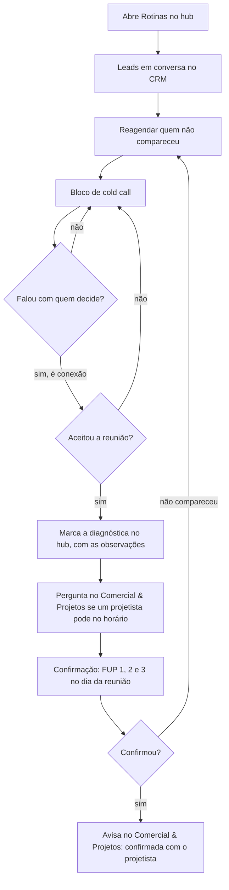

# Processo comercial da MecTRIA

Rascunho de 04/11/2026, a partir do que o Lucas descreveu. É o "processo visual hunter → closer" da Retórica (tarefa 18 do `03-plano-erp.md`): um fluxo de rotina, no estilo BPMN, que o hub transforma no dia de cada pessoa. A divisão entre hunter e closer vem do livro *Receita Previsível*, adaptada ao jeito de uma empresa júnior.

Partes prontas: as metas, o dia do hunter, o roteiro de cold call (com um rascunho de cold message), a confirmação da diagnóstica e o dia do closer. Falta o conteúdo das objeções.

## Metas (Lucas, 04/11/2026)

- **Meta dos hunters: 8 conexões por semana.** Só o hunter prospecta, então a meta é dele. Conexão é a ligação ou a conversa com quem decide. Substitui a meta antiga de 10 ligações por dia (cold call ou cold message), que ninguém cumpria, e a de 1 a 2 ligações por dia que estava no hub.
- **Meta de cada pessoa: cumprir a rotina do dia.** O que conta é o % da rotina feito, todo dia.

## 1. O dia do hunter

1. **Abre a aba Rotinas.** O dia começa pelo checklist do hub.
2. **Leads em conversa.** Primeiro, os leads que já estão em conversa no CRM da MecTRIA. Pela lista do CRM, são os de status "Contato estabelecido" e os com o marcador "Retornar" (leitura a confirmar; ver abaixo).
3. **Reagendamentos.** Depois, quem não compareceu à diagnóstica (no-show), para marcar de novo.
4. **Cold call.** Só então as ligações novas.
   - O que conta é a **conexão**: a ligação em que o hunter fala com quem decide.
   - O foco da ligação é **despertar a curiosidade** para o lead aceitar a reunião, não explicar o serviço.
   - O script de cold call e o de cold message ainda vão ser escritos.
5. **Marca a diagnóstica.** Registra no hub, com as observações importantes da ligação ou do WhatsApp, e pergunta no grupo **Comercial & Projetos** se algum projetista pode no horário.
6. **Confirma a reunião** com as três mensagens da seção 3.
7. **Avisa o time.** Com a confirmação do lead, informa no Comercial & Projetos que a reunião está confirmada com o projetista (leitura a confirmar).

**Os grupos (resposta de um hunter, 04/11/2026):** são dois. No **Comercial & Projetos**, o hunter pergunta se algum projetista pode em tal horário. No **Comercial**, o time troca ideia sobre o lead.

### Status e marcadores do CRM da MecTRIA (recebidos em 04/11/2026)

- **Status:** Não prospectado, Em prospecção, Contato estabelecido, No funil, Cliente e Perdido.
- **Marcadores automáticos** (pelo histórico): Ligação feita, Mensagem enviada e Nenhum contato registrado.
- **Marcadores:** Interesse Futuros, Lead Convertido, Lead Disponível, Lead Indisponível, Lead Não Consumado, Prospecção Passiva e Retornar.

Leitura, a confirmar na terça: "em conversa" é o status Contato estabelecido mais o marcador Retornar; "No funil" é quem já tem diagnóstica marcada; e "Interesse Futuros" é o mesmo "interesse futuro" da reativação (`16-pitch-e-fups.md`, seção 4).

## 2. Cold call

O objetivo da ligação é um só: marcar 30 minutos para a diagnóstica. A ligação não explica o serviço; ela desperta a curiosidade pela jornada de parcerias. As chaves entre `{}` vêm do lead: `{contato}`, `{segmento}` (pelo CNAE da Casa de Dados) e `{hunter}`.

**1. Abertura: pedir um minuto.**

> Fala, {contato}, tudo bem? Aqui é o {hunter}, da MecTRIA. Estou te ligando porque queria dividir com você, em um minutinho, uma jornada de parcerias que estamos abrindo com empresas de {segmento}. Você tem esse minutinho para eu te contar a ideia?

Se não tiver o minuto, pedir 30 segundos:

> Te entendo. Me dá só 30 segundos? Se não fizer sentido, eu te deixo tranquilo.

**2. Quem é a MecTRIA, com uma pergunta.**

> Bacana, {contato}, que bom que você topou. A MecTRIA é uma empresa do Movimento Empresa Júnior, o que significa que a gente não recebe para tocar os nossos projetos. Inclusive, você já ouviu falar do Movimento Empresa Júnior?

**3a. Se não conhece:**

> Legal. O Movimento Empresa Júnior é uma extensão da universidade. Com a orientação de professores, os graduandos aplicam o que aprendem em projetos reais, como já fizemos com {nº de clientes} clientes.

**3b. Se já conhece:**

> Que bom! Então você sabe que são projetos reais, feitos por graduandos com a orientação de professores. Já fizemos isso com {nº de clientes} clientes.

**4. A ponte para a reunião.**

> A ideia é a gente ter uma primeira reunião para entender qual é a maior prioridade de vocês hoje e se existe sinergia para a nossa jornada de parcerias. Na reunião eu te explico melhor como ela funciona, mas já te adianto: pelo que vocês fazem em {segmento}, temos viabilidade e capacidade produtiva para desenhar um projeto juntos que fique bom para os dois lados.

**5. O pedido.**

> O primeiro passo seria reservar 30 minutinhos da sua semana para entender, na prática, se existe sinergia para um projeto juntos ou não.

Sugestão: fechar com duas opções de horário, para a resposta ser uma escolha e não um sim ou não. Por exemplo, "Fica melhor terça às 10h ou quinta às 15h?".

### Cold message (rascunho, a partir do roteiro)

Para o WhatsApp, quando a ligação não completa ou como primeiro contato.

> Oi, {contato}, tudo bem? Aqui é o {hunter}, da MecTRIA. Estamos abrindo uma jornada de parcerias com empresas de {segmento} e queria dividir a ideia com você. Somos uma empresa do Movimento Empresa Júnior: projetos reais de engenharia, feitos por graduandos da UFTM com orientação de professores. Topa reservar 30 minutos esta semana para ver se existe sinergia para um projeto juntos?

## 3. Confirmação da diagnóstica

Três mensagens pelo WhatsApp, no dia da reunião. Só sai a seguinte se a anterior ficou sem resposta.

**FUP 1 · Ao começar o dia da reunião.**

> Opa! Tudo bem? Sou o {hunter}, da MecTRIA. Muito prazer! Estou passando para confirmar nossa reunião agendada para {data}, às {hora}. Achei importante confirmar antes porque a agenda está bem movimentada, com algumas reuniões em sequência, então é importante pegar contigo essa confirmação para aproveitarmos a agenda. Tudo confirmado?

**FUP 2 · 2 horas antes, se não respondeu.**

> Oi! Acabei não pegando essa confirmação contigo, está tudo certo?

**FUP 3 · 30 minutos antes, se ainda não respondeu.**

> Está por aí? 🙏

**Ao marcar** (rascunho), o hunter pergunta no Comercial & Projetos:

> Diagnóstica marcada: {empresa}, {data} às {hora}, {formato}. Algum projetista pode nesse horário?

**Quando o lead confirma** (rascunho), o hunter avisa no Comercial & Projetos:

> Reunião confirmada: {empresa} ({contato}), {data} às {hora}, {formato}, com {projetista}.

## 4. A diagnóstica

**Quem conduz:** normalmente o hunter, com um projetista (resposta da MecTRIA, 04/11/2026). O closer entra na proposta. No hub, o hunter que marcou a diagnóstica abre, conduz e encerra o painel, e o closer dono continua podendo abrir.

## 5. O dia do closer

A rotina do closer é organizada por prioridade, da etapa mais perto do fechamento para a mais longe. Cada bloco tem as suas tarefas, que contam no % do dia, e uma orientação. Se um bloco não tiver nenhum lead, a tarefa é marcada como feita.

As diagnósticas e as APs marcadas para o dia são obrigação de agenda, não tarefa de rotina, e não contam no %.

**Regra "sempre pra direita":** o lead está sempre andando em direção à negociação. Ele fica no máximo 3 dias em construção de proposta. Em Apresentação de Proposta pode esperar a data da AP, que às vezes é uma semana depois.

**1. Fechamento e negociação**
- Abrir o Follow-up pela manhã e fazer o FUP de todos os leads em negociação.
- **Prioridade máxima, senso de urgência:** qualquer contrato, ligação ou reunião que surgir vem primeiro. Uma oportunidade clara de fechamento, ou uma retomada quente, passa na frente da ordem do dia.

**2. Apresentação de Proposta (AP)**
- Abrir todos os leads em Apresentação de Proposta e fazer o FUP para definir o próximo passo.
- Mandar mensagem para agendar a AP. Quando estiver muito difícil marcar e a proposta estiver empacando, gravar um vídeo com a proposta personalizada e enviar. Os closers ainda não fazem isso; passam a fazer.
- *Orientação:* não deixar lead parado muito tempo nesta etapa.

**3. Construção de proposta**
- Abrir todos os leads em construção de proposta e construir as propostas pendentes.
- Chamar os leads para coletar o que ficou pendente da reunião, se faltar algo.
- *Orientação:* mandar o briefing para Projetos no mesmo dia. Nenhum lead fica mais de 3 dias nesta etapa.

**4. Reativação**
- Abrir a aba Reativação e enviar os FUPs planejados do dia.
- Avaliar se ainda existe aderência. Se não existir, encerrar a cadência (registrar como perdida).
- *Orientação:* a reativação é simples e constante. Sem aderência, o closer encerra sem gastar energia.

## 6. O que isso muda no hub

| O que muda | Onde | Hoje |
|---|---|---|
| A rotina do hunter segue a ordem do fluxo: leads em conversa, reagendamentos, bloco de cold call e confirmações do dia | Rotinas | Bloco de ligações, WhatsApp e registro das diagnósticas |
| A rotina passa a ser por blocos de prioridade, cada um com as suas tarefas, o progresso (feitas de total), a orientação e o % do dia. A do closer segue a seção 5 | Rotinas e Hoje | Uma lista única de itens |
| As metas passam a ser 8 conexões por semana dos hunters e o % da rotina por pessoa por dia | Hoje do hunter e do diretor | 1 a 2 ligações por dia |
| As reuniões do dia saem da rotina do closer (ficam na agenda e no Hoje) | Rotinas | O hub gera "Confirmar a diagnóstica com…" na rotina |
| Cada lead mostra há quantos dias está na etapa, com alerta quando passa de 3 dias em construção de proposta | Follow-up e Apresentações | Não tem |
| As ligações contam a **conexão** (falou com quem decide) separada de "atendeu" | Bloco de ligações | Não atendeu, atendeu e marcou |
| A diagnóstica marcada ganha o campo **Observações** | Marcar diagnóstica | Não tem |
| O roteiro do bloco de ligações passa a ser o da seção 2, com os desvios (30 segundos; conhece ou não o MEJ) e a cold message pronta para copiar | Bloco de ligações | Roteiro da versão 0.2 |
| Os 3 FUPs de confirmação aparecem como botões no dia da reunião, cada um na sua hora, com a mensagem pronta. "Confirmada" gera a mensagem do grupo | Hoje do hunter | Não tem |
| O fim da diagnóstica ganha "Cliente não compareceu", que volta a oportunidade para o hunter reagendar | Fechamento da diagnóstica | Só proposta marcada ou não qualificou |
| O hunter que marcou conduz a diagnóstica e abre o painel (fase 6) | Permissões e Reuniões | Só o closer dono ou o diretor |

## 7. Em aberto

O que depende da MecTRIA está também na pauta da reunião de 10/11, em `14-pedidos-a-mectria.md`.

| # | Pergunta | Quem responde |
|---|---|---|
| 1 | "Em conversa" é o status Contato estabelecido mais o marcador Retornar? | MecTRIA |
| 4 | O aviso de "confirmada" vai no Comercial & Projetos, citando o projetista? E o hub só gera o texto para copiar? | MecTRIA |
| 5 | Quantos clientes a MecTRIA já atendeu, para o {nº de clientes} do cold call (pedido 17). O Vinícius não tem o número; pedir ao Marcelo | Marcelo |
| 6 | Os professores orientadores são todos doutores? Pelo Vinícius, normalmente sim; o roteiro diz só "professores" até a MecTRIA confirmar (pedido 18) | MecTRIA |
