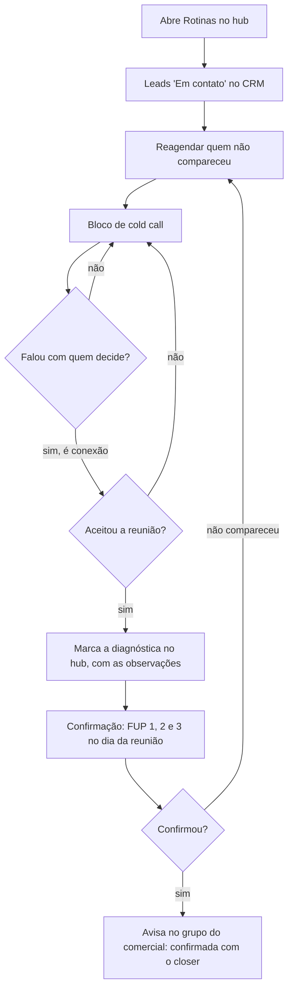

# Processo comercial da MecTRIA

Rascunho de 04/11/2026, a partir do que o Lucas descreveu. É o "processo visual hunter → closer" da Retórica (tarefa 18 do `03-plano-erp.md`): um fluxo de rotina, no estilo BPMN, que o hub transforma no dia de cada pessoa. A divisão entre hunter e closer vem do livro *Receita Previsível*, adaptada ao jeito de uma empresa júnior.

Partes prontas: o dia do hunter e a confirmação da diagnóstica. Faltam a diagnóstica (quem conduz), o processo do closer na proposta, os scripts de cold call e cold message, e as objeções.

## 1. O dia do hunter

1. **Abre a aba Rotinas.** O dia começa pelo checklist do hub.
2. **Leads "Em contato".** Primeiro, os leads que já estão em conversa no CRM da MecTRIA. O nome exato da etiqueta é a confirmar.
3. **Reagendamentos.** Depois, quem não compareceu à diagnóstica (no-show), para marcar de novo.
4. **Cold call.** Só então as ligações novas.
   - O que conta é a **conexão**: a ligação em que o hunter fala com quem decide.
   - O foco da ligação é **despertar a curiosidade** para o lead aceitar a reunião, não explicar o serviço.
   - O script de cold call e o de cold message ainda vão ser escritos.
5. **Marca a diagnóstica.** Registra no hub, com as observações importantes da ligação ou do WhatsApp.
6. **Confirma a reunião** com as três mensagens da seção 2.
7. **Avisa o time.** Com a confirmação do lead, informa no grupo do comercial que a reunião está confirmada com o closer.

## 2. Confirmação da diagnóstica

Três mensagens pelo WhatsApp, no dia da reunião. Só sai a seguinte se a anterior ficou sem resposta.

**FUP 1 · Ao começar o dia da reunião.**

> Opa! Tudo bem? Sou o {hunter}, da MecTRIA. Muito prazer! Estou passando para confirmar nossa reunião agendada para {data}, às {hora}. Achei importante confirmar antes porque a agenda está bem movimentada, com algumas reuniões em sequência, então é importante pegar contigo essa confirmação para aproveitarmos a agenda. Tudo confirmado?

**FUP 2 · 2 horas antes, se não respondeu.**

> Oi! Acabei não pegando essa confirmação contigo, está tudo certo?

**FUP 3 · 30 minutos antes, se ainda não respondeu.**

> Está por aí? 🙏

**Quando o lead confirma**, o hunter avisa no grupo do comercial:

> Reunião confirmada: {empresa} ({contato}), {data} às {hora}, {formato}, com {closer}.

## 3. A diagnóstica

**Quem conduz (a confirmar com a MecTRIA).** Parece ser flexível: já houve diagnóstica conduzida pelo hunter junto com o closer. As combinações possíveis são hunter + projetista, closer + projetista, ou hunter + closer.

## 4. A proposta

Aqui começa o processo do closer. Próximo tema a descrever.

## 5. O que isso muda no hub

| O que muda | Onde | Hoje |
|---|---|---|
| A rotina do hunter segue a ordem do fluxo: leads "Em contato", reagendamentos, bloco de cold call e confirmações do dia | Rotinas | Bloco de ligações, WhatsApp e registro das diagnósticas |
| As ligações contam a **conexão** (falou com quem decide) separada de "atendeu" | Bloco de ligações | Não atendeu, atendeu e marcou |
| A diagnóstica marcada ganha o campo **Observações** | Marcar diagnóstica | Não tem |
| Os 3 FUPs de confirmação aparecem como botões no dia da reunião, cada um na sua hora, com a mensagem pronta. "Confirmada" gera a mensagem do grupo | Hoje do hunter | Não tem |
| O fim da diagnóstica ganha "Cliente não compareceu", que volta a oportunidade para o hunter reagendar | Fechamento da diagnóstica | Só proposta marcada ou não qualificou |
| Se a diagnóstica puder ser conduzida pelo hunter, ele passa a poder abrir o painel | Permissões | Só o closer dono ou o diretor |

## 6. Em aberto

| # | Pergunta | Quem responde |
|---|---|---|
| 1 | O nome da etiqueta dos leads em conversa no CRM ("Em contato"?) | MecTRIA |
| 2 | Quem conduz a diagnóstica: hunter, closer, projetista, ou varia? | MecTRIA, na call |
| 3 | Qual é a meta do hunter: ligações ou conexões por dia? | Lucas e Marcelo |
| 4 | Em que grupo o hunter avisa a confirmação, e se o hub deve só gerar o texto para copiar | MecTRIA |
